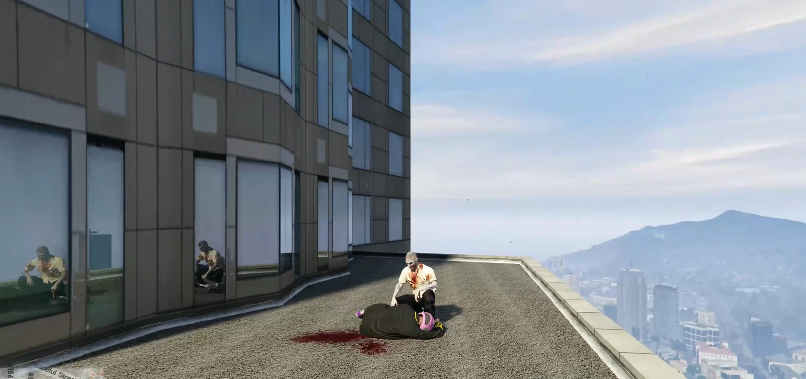
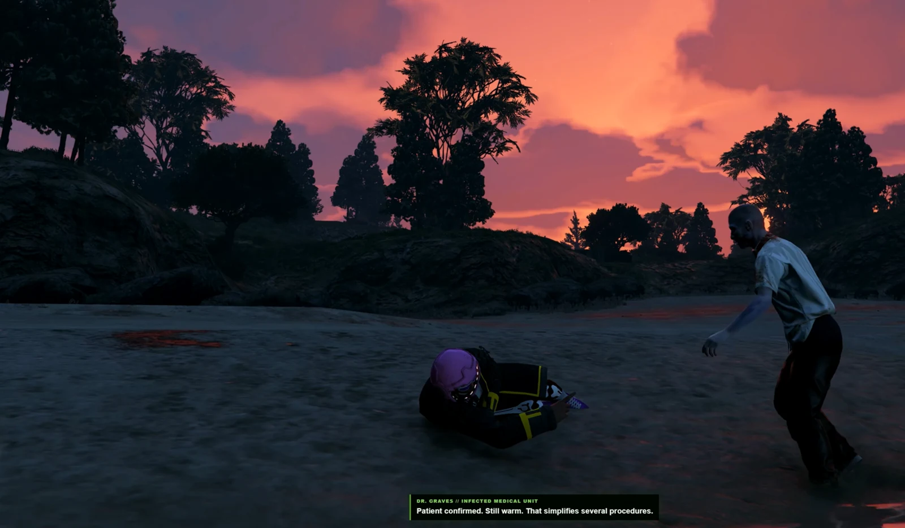
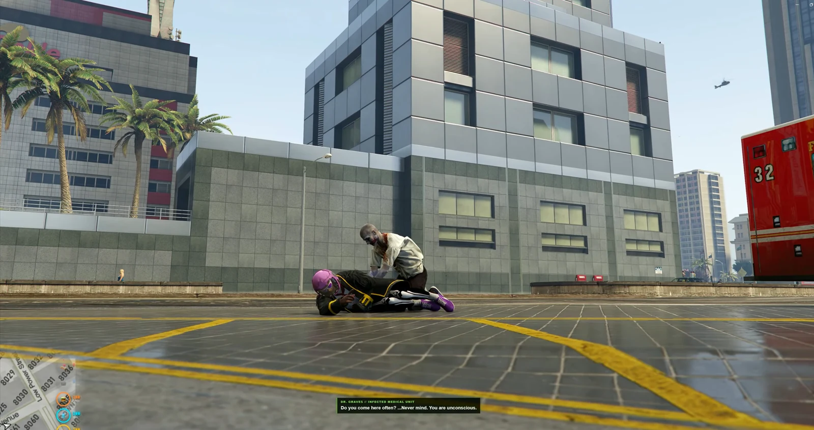
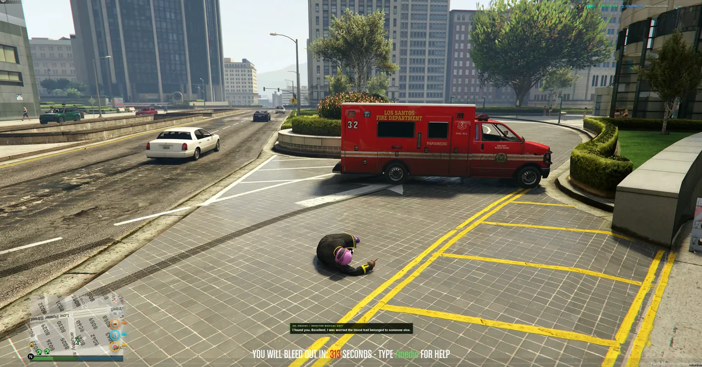

# RS AI DOC — Zombie EMS Rescue

<a href="https://reality-sucks-rp-webstore.tebex.io/package/7737475"></a>

No EMS on duty? Dr. Graves answers the call. This voiced zombie medic drives an ambulance to injured players, examines them and performs CPR. Medical animations, emergency response and an undead personality bring a memorable rescue service to survival and city RP.

[Download the original ZIP](https://github.com/RealitySucksRP/rs-aidoc/releases/latest/download/rs-aidoc.zip) | [Free on Tebex](https://reality-sucks-rp-webstore.tebex.io/package/7737475) | [Watch preview](https://youtu.be/DhZvbTEIA8Y) | [Website](https://realitysucksrp.github.io/) | [Discord](https://discord.gg/e9V3rPHySx) | [YouTube](https://www.youtube.com/@RealitySucksRP) | [All free scripts](https://reality-sucks-rp-webstore.tebex.io/category/free-scripts)

**Install folder:** `rs-aidoc`. Download the original ZIP to retain the package folder layout. Source, configuration, licenses and included assets are provided below.

<details>
<summary>More screenshots</summary>









</details>

## Package documentation

# rs-aidoc — Dr. Graves

Zombie-apocalypse autonomous trauma responder for FiveM.

## ⚠ Framework note

**Developed and tested on Qbox (`qbx_core`) + ox_inventory, GTA V Enhanced.**

`Config.Framework = 'auto'` -- the resource detects `qbx_core`, `qb-core` or
`es_extended` at runtime rather than being compiled against one. QBCore and ESX
are supported-but-unverified: the code paths exist, nobody has run a full call
on them.

Watch for the usual trap when moving this to a QBCore server: `qbx_core`
declares `provide 'qb-core'`, so `exports['qb-core']` resolves on Qbox and a
framework mismatch starts cleanly and breaks subtly later. **A resource starting
without errors is not evidence it is framework-correct.**

The included adapters handle framework, payment, notification, progress, death-state and medical-provider integration without requiring an additional external adapter.

See `COMPATIBILITY_AND_LIVE_TESTS.md` supplied in this resource.


Dr. Graves is an infected former doctor who responds to injured, laststand or dead survivors, drives an ambulance to the scene, diagnoses the likely trauma, performs an animated kneeling exam and CPR-style treatment for both conscious injuries and downed patients, then heals or revives through the medical provider, charges the configured treatment fee, and delivers randomized dark-humor voice dialogue during the rescue.

## Player command

`/medic`

`/aidocdiag` prints the current scene stage, doctor/ambulance distances, driving recovery count, and running animation state in F8. It is read-only and does not affect billing or treatment.

## Framework bridge

`rs-aidoc` keeps gameplay framework-neutral. Framework detection, player/job data, dead/down state, notifications, progress, cash/bank payment, and revive dispatch are owned by its files under `bridge/`.

Supported standard stacks:

- **Qbox:** `qbx_core` + `qbx_medical`
- **QBCore:** `qb-core` + `qb-ambulancejob`
- **ESX Legacy:** `es_extended` + `esx_ambulancejob`

A living patient can request `/medic` when health is down by at least 5 points or when Qbox reports bleeding/limb injuries. Healthy characters are rejected. `Config.RequireDead = true` restores down-only behavior, and `Config.RequireInjury = false` permits all living players. Patient eligibility is checked again before billing and on completion. Patients who remain conscious are healed without being resurrected, while laststand/dead patients follow their medical-provider revive path.

Current provider behavior:

- Qbox revive uses the server-side `qbx_medical:Revive` export; conscious medical care uses the separate `qbx_medical:Heal` export (including its injury/bleeding state).
- QBCore revive uses the current `hospital:client:Revive` provider event.
- ESX Legacy revive uses `esx_ambulancejob:revive`.
- Conscious QBCore/ESX/standalone treatment restores native player health without triggering revive events. Custom bleeding/injury modules still require dedicated healing adapters.

If no medical resource is installed, the local adapter falls back to a native revive. Dr. Graves still works, but death state owned by a medical resource (injuries, respawn timers, bleed-out) is not cleared because there is nothing holding it. Install the medical resource that matches your framework for the intended behavior.

The server waits up to 8 seconds for a session-bound client recovery observation and independently cleared server medical state. Qbox observation additionally waits for the provider's revive event, full ped health and released inventory lock. A dispatched but unconfirmed revive is recorded for administrator review, not automatically refunded: a delayed revive may still succeed. A definite provider rejection before dispatch requests a refund. Custom ESX ambulance scripts that do not expose the standard `isDead` state bag need a dedicated adapter.

## Conflicts

`/medic` must be registered by this resource only. Stop or remove any other AI-medic resource that binds the same command — `hh_aidoc` is the common one, since `rs-aidoc` supersedes it.

## Payment

Treatment is server-authoritative. The default price is `$500`; the internal adapter checks configured accounts in priority order and removes the money only when treatment begins. On Qbox with `qb_protect_cash_while_dead=1`, carried cash is intentionally skipped and bank is selected because Qbox rejects dead-player cash removal. Payments are bound to the original character, not a reusable player source. Qbox mutations use the original citizen ID. A resource KVP journal records payment intent, confirmation, refunds and ambiguous outcomes. Confirmed pre-revive failures refund the original character when online, or defer until that character returns. Uncertain debit, credit or revive outcomes require administrator review and block another paid call for that character.

## EMS availability

By default Dr. Graves is available only when no configured real EMS job is on duty. Job names and the threshold are configurable in `config.lua`.

## Audio

The persona build uses **8 explicit AI Doc voice branches**. Facial animation (`PlayFacialAnim` with GTA `mp_facial : mic_chatter`) follows the start/end callbacks of actual NUI audio playback and can be turned off with `Config.Audio.LipMovement = false`. The talking expression is approximate, not phoneme-perfect, and visibility depends on the selected GTA ped model supporting the facial animation dictionary. One persona is chosen when `/medic` begins and remains locked through dispatch, arrival, trauma observation, CPR, revive, and departure.

The resource contains **124 dialogue slots** across 13 categories. Each persona has at least one line in every category, so the runtime never needs to switch to another speaker. If a future content edit accidentally removes a category from one persona, the audio system falls back only to that same persona's generic medical line.

The production OGG pack is generated from the eight configured ElevenLabs voice IDs by the companion one-click builder. The builder uses one fixed model/settings profile and one fixed seed per persona so each branch is generated consistently.

## Start order

Enable OneSync and start the framework and its medical resource first, then Dr. Graves. Start `progressbar` first when installed; the internal adapter has a native progress display fallback. After applying a manifest update, run `refresh` before `restart rs-aidoc`.

```cfg
# ensure your framework/core and medical resource before this
ensure rs-aidoc
```

## Configuration

Main gameplay settings are in `config.lua`, including price, cooldown, EMS jobs, responder models, spawn radius, treatment timing, departure behavior, and audio settings. `Config.Dispatch.RelocateAfterSeconds` controls how long the ambulance may try to reach the patient before the same doctor is safely moved nearby; `RelocateDistance` controls that nearby offset. The `Departure*` settings control the return-to-ambulance, drive-away distance, and cleanup timeouts.

## Session and entity safety

The server creates and tracks the responder in the patient's routing bucket. Treatment requires the original doctor's entity/network ID, model, bucket, server-observed proximity (entity ownership may migrate under OneSync); a session token alone is insufficient. Departure has a server cleanup deadline as well as client cleanup.

- A denial that arrives after Graves exists sends him back to the ambulance to leave naturally; he is not deleted beside the patient.
- If the ambulance cannot reach the patient by `Config.Dispatch.RelocateAfterSeconds`, the existing doctor is extracted, moved beside the patient, and continues through the same arrival and server-authorized treatment flow. No second responder or second treatment session is created.
- If Graves reaches the area but cannot finish the walk by `Config.Dispatch.ApproachTimeoutSeconds`, that same nearby relocation is attempted once; a second approach failure cancels and cleans up the call.
- After a successful treatment, Graves gets up, runs back to the ambulance on the pedestrian navmesh, boards the driver seat, and drives away. Cleanup happens only at the configured safe departure distance or timeout; if the vehicle was stranded too far away and deleted during rescue, he leaves on foot instead.
- With `Config.Dispatch.InvincibleDoctor = true`, Graves cannot take damage, suffer critical hits, be targeted, or ragdoll out of the CPR sequence.
- The dispatch window covers driving, two approach attempts and startup overhead (215 seconds with the supplied config). Paid treatment has a separate deadline. Confirmed pre-revive cancellations are refundable; ambiguous in-flight outcomes remain in the journal for review.
- Completion is only accepted once the procedure could plausibly have finished, so the treatment timing cannot be skipped client-side.

## v0.1.13 — dialogue-only mouth animation (10-14-2026)

Dr. Graves now uses `PlayFacialAnim('mic_chatter', 'mp_facial')` when a
prerecorded clip actually starts, refreshes that expression periodically while
the clip plays, and returns to a neutral expression at the clip's end.
The old lip code skipped animation entirely if network control could not be
acquired. This cosmetic animation no longer requests or waits for ped ownership.
`Config.Audio.MouthRefreshMs` adjusts refresh rate; `LipMovement = false`
disables it. The talking expression remains a fallback for older builds.

**Change boundary:** only `client/audio.lua`, audio configuration, manifest
version and documentation were touched. `client/main.lua`, both medical paths,
server authorization/payment, NUI playback and all audio files are unchanged.
Facial motion is not word-level sync. Visibility on `u_m_y_zombie_01` requires
an in-game close-up check; a facial native completing is not proof of visible
jaw movement. No live server test was performed on this build.

## v0.1.12 — OneSync treatment distance authorization (10-14-2026)

Fixes `/aidocdiag` showing the doctor **0.5m away** while server authorization
continually reports `doctor_too_far` and the client leaves without CPR or
medical recovery. This was an authorization gate failure, not missing anim
assets: kneeling and CPR never started because `treatmentAuthorized` never
arrived. The exact reason for server/client coordinate disagreement requires
live sync diagnostics; a stale OneSync sync-tree ped position is one plausible
cause.

- The server first validates its original doctor/ambulance net identities,
  configured models, patient bucket and server ped distance.
- If server ped distance is unexpectedly high, a bounded fallback requires a
  matching doctor net ID, locally observed doctor near the patient, patient
  position consistent with server sync, server-observed ambulance within 22-30m
  (or valid server-authorized patient-side relocation), and a valid dispatch age.
  Client position alone never authorizes care. An attacker who forges their
  client observations is still a threat model; corroboration limits the window
  but does not cryptographically prove a particular animation played.
- Once the session is charged and CPR is approved, final validation checks the
  original responder, character, bucket and patient proximity to the approved
  treatment location instead of rejecting a valid 20-second medical procedure
  when the doctor's server-reported coordinates become stale.
- `/aidocdiag` shows both local positions and the last server-reported doctor,
  ambulance and patient coordinate gaps while authorization is pending.
- Preserves the v0.1.11 classic kneel/CPR clips, medical providers, payment
  journal, dialogue, ambulance GPS and return-to-vehicle choreography.

**Test coverage:** all Lua source chunks compile; 16 mocked responder proximity
checks and 3 mocked classic-CPR flow checks pass; NUI JavaScript syntax passes.
**Still requires live FiveM/OneSync verification** of synchronized ped positions,
CPR playback, revival and departure.

## v0.1.11 — restore proven kneel and CPR flow (10-14-2026)

Compared the supplied working `rs-aidoc-oldone.zip` against `rs-aidoc(5).zip`.
The Codex package inserted strict bone-index, nearby-navmesh, hand-geometry and
animation-watchdog checks **before** or **during** CPR. These can abort the scene
on ragdolled patients, custom interiors or model rigs even if Dr. Graves is next
to the patient. The exact runtime cause still requires an F8 log from FiveM.

The default `Config.Treatment` animation pair is restored directly from the
working ZIP:

- Examination: `amb@medic@standing@tendtodead@base : base`
- CPR: `mini@cpr@char_a@cpr_str : cpr_pumpchest`

The newer requested animations remain selectable in `FallbackKneelAnim*` and
`FallbackCPRAnim*` and are attempted when the primary clip does not start:
`rcmfanatic3 : kneel_idle_a`, `missheistfbi3b_ig8_2 : cpr_loop_paramedic`.
To prioritize the newer clips, exchange the primary and fallback values in
`Config.Treatment`. No other code changes are required.

Dr. Graves still faces chest bone `24816`, but the calculation no longer
blocks kneeling or CPR when navmesh or hand positions are imperfect. Ownership
requests and playback checks are best-effort, and the scene watchdog retries
an interrupted animation without cancelling treatment for geometry drift or a
late animation confirmation. If both clips fail to load altogether, the scene
still records an animation failure and stops safely.
The one-charge server-authoritative treatment, medical-provider confirmation,
AIDOC ambulance, routing recovery, dialogue/lip animation, and departure flow
remain the same as the supplied Codex package.

**QA:** all 13 Lua chunks compile and NUI JS passes `node --check`.
Mocked scene tests cover treatment alignment without strict navmesh checks,
playing with pending entity control and fallbacks if the primary clip fails.
**No live FiveM test was performed.** Verify animation poses on the zombie model
and the entire rescue before a production release.

## v0.1.9 — kneel/CPR and faster medical dispatch (10-13-2026)

- At the time, Graves was intended to face the player and visibly **kneel using `rcmfanatic3 : kneel_idle_a`**, stays in the examination pose during the recorded diagnosis, then **performs `missheistfbi3b_ig8_2 : cpr_loop_paramedic`** for the treatment timer. CPR-style visuals are used for injured/conscious patients too; healing remains a heal (never a revive), and a standing patient will not be forcibly ragdolled or put into death state.
- Animation start is checked with `IsEntityPlayingAnim` and older CPR has a fallback. A per-call watchdog reasserts the current clip if GTA or a network ownership transition interrupts it; debug logs show animation successes/restores and bone distance.
- The doctor stands up once medical recovery is confirmed, finishes his lines, runs toward the ambulance, enters, and drives away. If a scene was inaccessible, the server retains an ambulance within ~40m so he can still return; genuinely stranded distant ambulances are removed during an authorized fallback and departure is on foot.
- The driving GPS now targets the **nearest reachable roadway node**, not the victim's raw off-road/interior coordinates. Dispatches originate from candidate road nodes ~48–85m away, and road waypoint updates occur if the patient moves substantially. A vehicle near the road goal stops there and the doctor finishes the approach on foot.
- Road movement uses distance-to-waypoint progress rather than speed alone to detect stalls, attempts a short reversing task and two route recalculations, and escalates to a server-authorized rescue after the configured time. Pedestrian navmesh tasks are no longer overwritten every 750ms; an approach watchdog retries only after a few seconds of stalled progress.
- `/aidocdiag` (client F8) prints the current stage, animation clip/is-playing state, actor distances, route retry counter, and authorization gate. Enable `Config.Debug=true` for further routing and visual-stage logs.
- Retains living-player healing, framework-sensitive dead/laststand revival, spoken-dialogue facial movement, `AIDOC` plate, server-side billing, entity validation and settlement journal.

**Limitations:** GTA has no general guarantee that its navmesh can reach a modded interior, fenced area, roof or inaccessible island. A server-authorized nearby-responder fallback is still required. Chest-bone facing aligns Graves to the torso but does not synchronise a standing conscious patient's pose; this avoids changing the patient's movement/death state. Only real in-game inspection can confirm visual fidelity and zombie facial rig support.

**Historical v0.1.9 checks:** 13 Lua chunks compiled using LuaTeX `loadfile`; JavaScript passed `node --check`; 9 existing medical/security mock checks and 9 additional responder route/relocation checks were reported as passed. No FiveM client or networked-world instance was available for an in-game animation test.

## v0.1.8 changes and validation boundary

- Wounded conscious, laststand and dead players are eligible by default; uninjured players cannot order unnecessary treatment. A client cannot choose the treatment outcome: the server determines whether to heal or revive after the required procedure time.
- Dr. Graves uses a non-CPR exam animation and generic medical dialogue when treating conscious players. Qbox healing uses `qbx_medical:Heal`; other frameworks get native health restoration without resurrection.
- The ambulance plate is `AIDOC`, applied at creation and on the client.
- Dr. Graves' facial animation follows actual recorded dialogue playback. This is approximate mouth movement dependent on the zombie model's facial rig; live visual validation is still needed.
- Replaced the client-owner equality condition that silently rejected a network-migrated doctor; the server still validates original entity/net ID, model, bucket, and treatment proximity.
- Added logged treatment authorization-gate reasons and safe departure rather than instant deletion when a treatment attempt times out.

**Static checks:** all 13 resource Lua chunks pass LuaTeX's `loadfile` syntax check and NUI JavaScript passes `node --check`. These are source checks, **not FiveM/OneSync live gameplay tests**, and do not validate the zombie model's facial rig, real medical-provider state, QBCore/ESX-specific injury removal, real billing, or network migration. Test with one or more live clients before publishing a fully certified release. All existing OGG audio clips remain included.

## Payment review commands

Server console only:

```text
aidocsettlements
aidocsettle <review-id> refund
aidocsettle <review-id> complete
```

Inspect the original character's provider/account history and medical outcome first. Use `refund` only when a charge occurred, treatment did not settle, and no refund was already credited. It queues credit for the original character, never their replacement. Use `complete` when treatment or reimbursement already settled, or a charge never occurred. Back up server resource KVP data; do not erase the journal to unblock calls. See `COMPATIBILITY_AND_LIVE_TESTS.md`.

## v0.1.5 framework safeguards

The internal bridge verifies ESX cash/bank balance deltas after account mutations instead of accepting a silent function return as success. Legacy ESX cash methods are supported when `getAccount('money')` is not available. Ambiguous charge attempts are logged with `PAYMENT REVIEW REQUIRED` and are **not** retried on another account. Qbox client player data falls back to its update event if the export is unavailable. Real provider revives must clear server-observed death state before AI Doc completes. See `COMPATIBILITY_AND_LIVE_TESTS.md` for provider caveats and live test steps.

